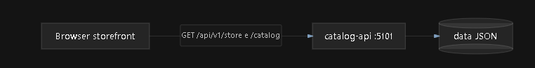
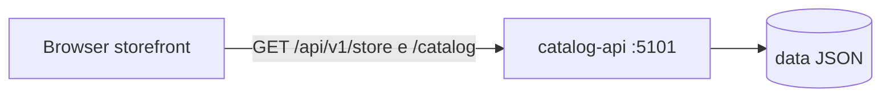

# Getting Started — ambiente local

Guia para subir e validar o monorepo **Fabin Lanches** no seu computador.  
Visão do produto: [README.md](../README.md) · Deploy: [README-DEPLOY.md](../README-DEPLOY.md) · Arquitetura: [architecture.md](architecture.md)

## Em uma frase

O **front só exibe**; a **API C#** entrega loja + cardápio (JSON ou PostgreSQL). Admin e pedidos são peças extras. Use sempre `apps/storefront` (não a raiz legada do repositório).





## Pré-requisitos

1. **Node.js** — fronts (`npm start`)
2. **.NET 10 SDK** — APIs (`dotnet run`)
3. **Docker Engine no Ubuntu WSL2** — para a stack completa (Postgres, RabbitMQ, Jaeger, gateway)

```powershell
dotnet --version
node --version
```

Modelo de variáveis: [`.env.example`](../.env.example). Não versionar `.env` real.

O Docker Engine roda no Ubuntu WSL2. A CLI do Windows usa o contexto `ubuntu-wsl-engine`, enquanto a CLI dentro do WSL usa o socket local; ambas acessam os mesmos containers. Para executar o Compose deste projeto pelo Windows, use `npm run dev:up`/`npm run dev:down` ou `.\scripts\docker-compose-wsl.ps1`, que resolve os caminhos de bind dentro do WSL.

## Opção A — Subir tudo (recomendado)

Com o Ubuntu WSL2 iniciado, na raiz do repositório:

```powershell
npm run dev:up
```

Ou: `.\scripts\dev-up.ps1`

| O quê | URL |
|-------|-----|
| Cardápio (storefront) | http://localhost:8080 |
| Admin | http://localhost:8081 |
| Gateway API | http://localhost:5100 |
| Jaeger | http://localhost:16686 |
| RabbitMQ | http://localhost:15672 (`guest` / `guest`) |

O script aponta os `api-config.js` para o gateway (`http://localhost:5100`) e abre o browser.

Encerrar:

```powershell
npm run dev:down
```

## Opção B — Sem Docker (API JSON + fronts)

O script sobe a `catalog-api` em `:5101`, o gateway em `:5100` e os fronts. O storefront usa o gateway automaticamente.

```powershell
npm run dev:up:light
npm run dev:down:light
```

Persistência local padrão: arquivos em [`data/`](../data/) (`products.json`, `store-config.json`, etc.).

## Opção C — Passo a passo manual

### Caminho 1 — Mínimo (cardápio + catalog-api)

**Terminal 1 — API**

```powershell
cd services/catalog-api
dotnet run --launch-profile http
```

Espere “Now listening on: http://localhost:5101”.

Testes:

- http://localhost:5101/api/v1/health
- http://localhost:5101/api/v1/store
- http://localhost:5101/api/v1/catalog
- OpenAPI: http://localhost:5101/openapi/v1.json

Em [`apps/storefront/assets/script/api-config.js`](../apps/storefront/assets/script/api-config.js):

```js
window.API_BASE_URL = window.API_BASE_URL || 'http://localhost:5101';
```

**Terminal 2 — Cardápio**

```powershell
cd apps/storefront
npm start
```

Abra: http://localhost:8080

### Caminho 2 — Painel admin

Com a catalog-api no `:5101`:

```powershell
cd apps/admin
npm start
```

- URL: http://localhost:8081  
- Login local: ver tabela de credenciais abaixo  
- Em [`apps/admin/api-config.js`](../apps/admin/api-config.js), a URL deve apontar para a mesma API (`5101` ou gateway `5100`)

Fluxo: login → alterar loja/categorias/produtos → recarregar o storefront.

### Caminho 3 — Stack Docker manual

1. Inicie o Ubuntu WSL2 no PowerShell: `wsl -d Ubuntu -- true`.  
2. Fronts apontando para o **gateway** `http://localhost:5100`.  
3. Na raiz:

```powershell
.\scripts\docker-compose-wsl.ps1 up --build -d
```

O helper executa Compose dentro do WSL para converter corretamente os caminhos de bind do Windows. Os serviços usam `restart: "no"`: só iniciam quando você executa manualmente um comando de subida e não reiniciam com o Docker ou o computador.

| URL | Serviço |
|-----|---------|
| http://localhost:5100 | Gateway |
| http://localhost:16686 | Jaeger |
| http://localhost:15672 | RabbitMQ |

Desligar: `.\scripts\docker-compose-wsl.ps1 down`.

Se catalog/orders falharem na 1ª subida (Postgres ainda iniciando), aguarde ~15s ou:

```powershell
.\scripts\docker-compose-wsl.ps1 restart catalog-api orders-api
```

## Portas

| Serviço | Porta |
|---------|-------|
| Storefront | 8080 |
| Admin | 8081 |
| Gateway | 5100 |
| catalog-api | 5101 |
| orders-api | 5102 |
| PostgreSQL | 5432 |
| RabbitMQ / UI | 5672 / 15672 |
| Jaeger | 16686 |

## Atalhos npm (raiz)

```powershell
npm run dev:up         # Docker + fronts
npm run dev:down
npm run dev:up:light   # API JSON + fronts
npm run catalog        # só catalog-api :5101
npm run orders         # só orders-api :5102
npm run gateway        # só gateway :5100
npm run storefront     # :8080
npm run admin          # :8081
npm run docker:up
npm run docker:down
```

## Credenciais de desenvolvimento (só local)

| Item | Valor | Papel |
|------|-------|--------|
| Admin da loja | `admin` / `admin123` | Pedidos, Dashboard, Loja, Categorias, Produtos |
| Plataforma (Dev) | `dev` / `dev123` | Lojas / Sistemas |
| Atendimento | `atendimento` / `atendimento123` | Pedidos |
| JWT key (dev) | em `appsettings.Development.json` | — |
| PostgreSQL (Docker) | `delivery` / `delivery` | porta 5432 |

**Não use em produção.** Em produção: variáveis no host (ver [README-DEPLOY.md](../README-DEPLOY.md)).

## Persistência

- **Json** (local / light): `data/products.json`, `data/store-config.json`, …
- **PostgreSQL**: `Persistence=PostgreSQL` + connection string (Compose / `dev:up` já configura)

Bridge PHP opcional: [`infra/php-bridge/index.php`](../infra/php-bridge/index.php).

## Ordem mental de aprendizado

1. Sem API → front mostra erro de carregamento.  
2. catalog-api + storefront → MVP.  
3. + admin → CRUD seguro.  
4. + Docker (gateway, orders, fila, traces) → stack completa.

## Se algo falhar

| Sintoma | Causa comum |
|---------|-------------|
| “Não foi possível carregar o cardápio” | API fora ou `api-config.js` com porta errada |
| `dotnet` não roda | SDK .NET 10 não instalado |
| Porta em uso | Processo antigo em 5101/8080/8081 |
| Admin não loga | API fora ou URL diferente do `api-config.js` |
| Cache antigo no celular/PWA | Ctrl+F5 ou limpar service worker |

## Próximos passos

- Guias por recurso: [guides/](guides/)  
- Arquitetura: [architecture.md](architecture.md)  
- Specs de features: [specs/](specs/)  
- Como alterar com segurança: [guides/06-como-atualizar.md](guides/06-como-atualizar.md)  
- Deploy: [README-DEPLOY.md](../README-DEPLOY.md)  
